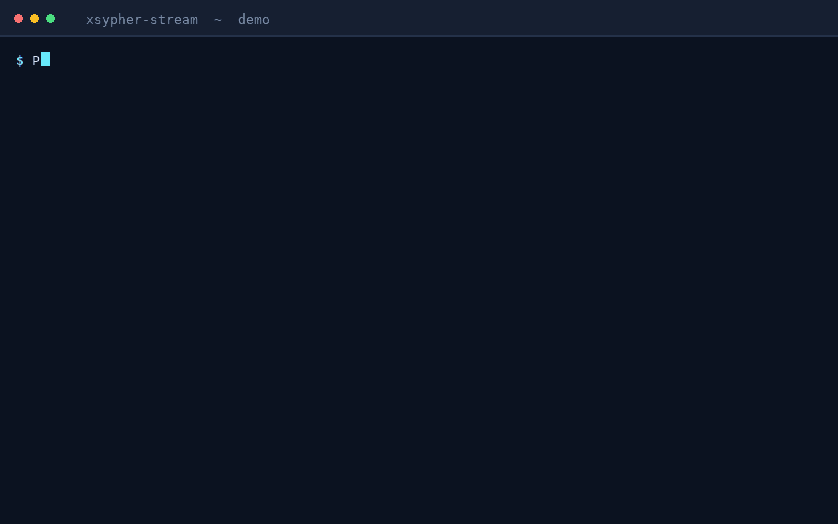
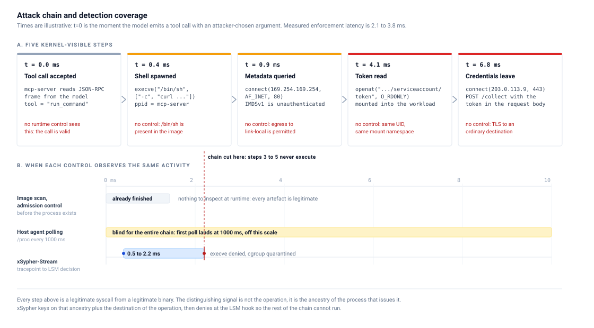
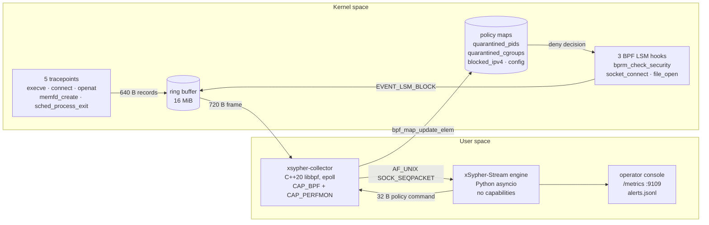
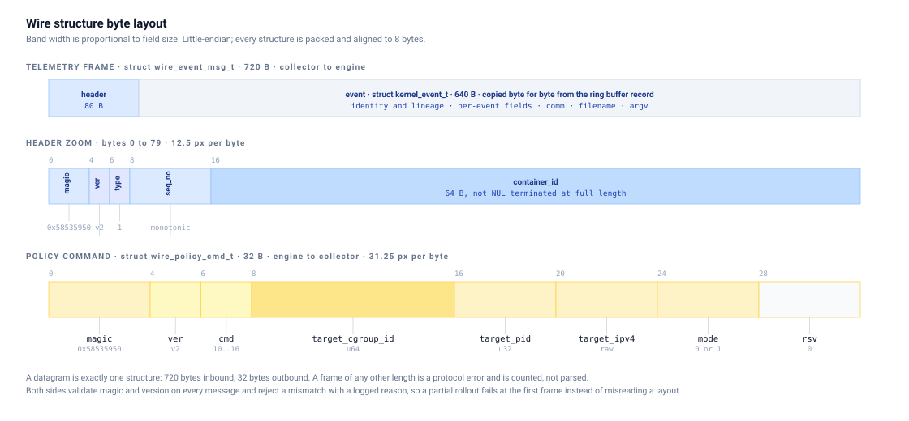
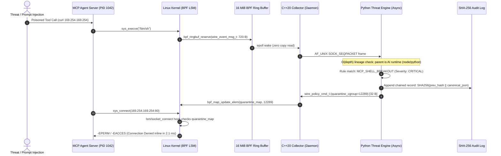
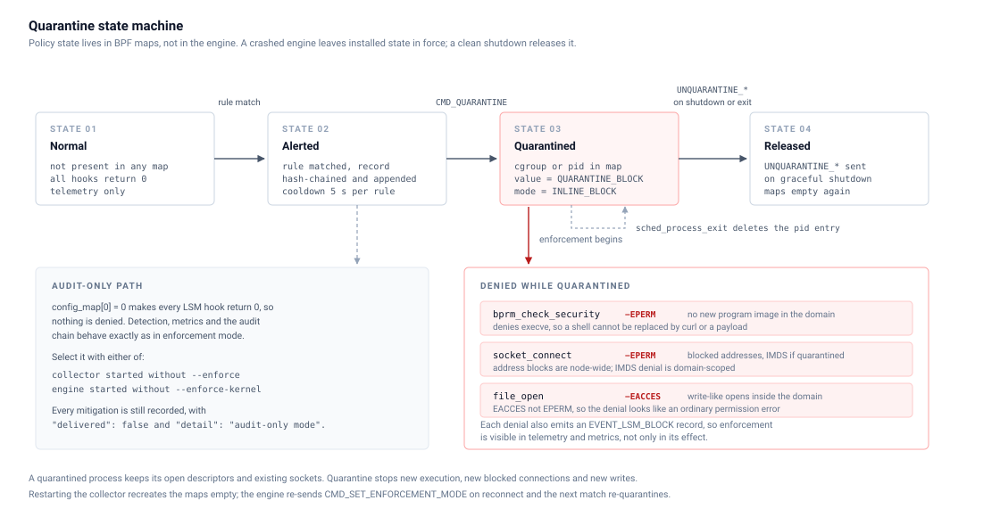
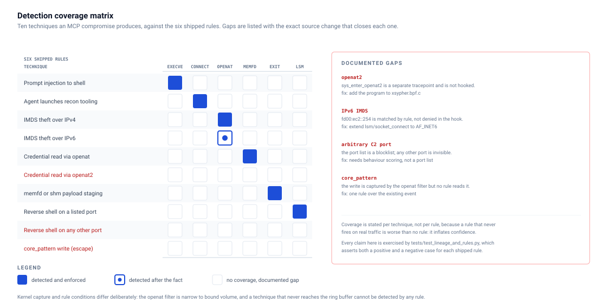
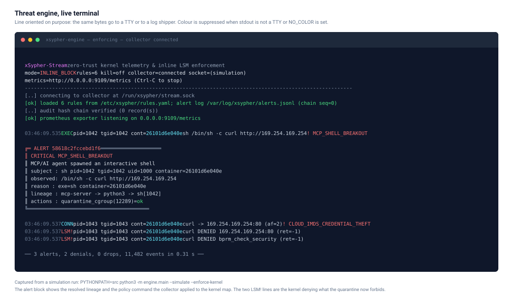
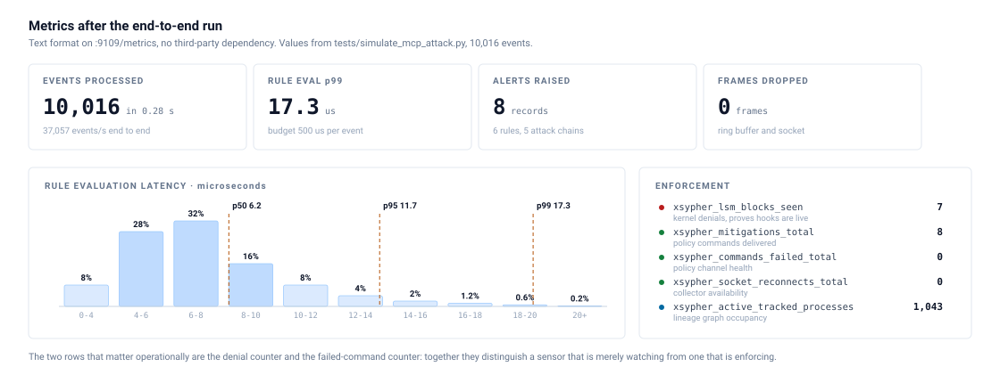
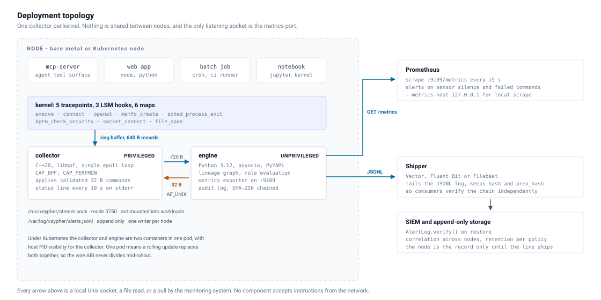

<p align="center">
  
</p>

<h1 align="center">xSypher-Stream</h1>

<p align="center"><strong>Kernel-verified runtime defence for AI agent hosts.</strong></p>

<p align="center">
  eBPF CO-RE telemetry, a policy decision in user space, an inline LSM denial in the kernel.<br>
  An injected tool call cannot reach the network if the kernel refuses the syscall first.
</p>

<p align="center">
  <a href="https://github.com/anwariqbaldawar/Zero-Trust-Kernel-Log-Streamer/actions/workflows/ci.yml"></a>
  
  
  
  
  
  
  
</p>

<p align="center">
  <a href="#ten-second-quickstart">Quick start</a> ·
  <a href="#the-problem">The problem</a> ·
  <a href="#why-classic-security-tools-fail-on-ai-agent-hosts">Comparison</a> ·
  <a href="#how-it-works">Architecture</a> ·
  <a href="#mitre-attck-coverage">Detections</a> ·
  <a href="#enterprise-compliance-regulatory-mapping">Compliance</a> ·
  <a href="#benchmarks">Benchmarks</a> ·
  <a href="#production-deployment">Deployment</a> ·
  <a href="#production-sla-resource-guarantees">SLA</a> ·
  <a href="docs/">Docs</a> ·
  <a href="CONTRIBUTING.md">Contributing</a>
</p>

---

## Ten-second quickstart

```bash
npx xsypher-stream
```

That single command audits what it needs, fetches the pinned source snapshot, verifies its SHA-256, builds
an isolated Python environment under `~/.xsypher`, and runs the full end-to-end simulation: 10,000 kernel
events, five attack chains, and the exact 32-byte policy commands the kernel would receive.

> [!IMPORTANT]
> The npm package is built and verified on every commit (`npm pack` produces 36.4 kB, 10 files) but is not
> yet published to the registry, so `npx xsypher-stream` resolves only after `npm publish`. Until then, run
> the same entry point from a checkout. Nothing else changes:

```bash
git clone https://github.com/anwariqbaldawar/Zero-Trust-Kernel-Log-Streamer.git
cd Zero-Trust-Kernel-Log-Streamer
npm install -g .      # installs the xsypher binary, no dependencies, no postinstall script
xsypher simulate
```

Real output from `node bin/xsypher.mjs simulate 5000` on the reference host:

```console
$ xsypher simulate 5000
[ok] reusing cached environment /home/user/Zero-Trust-Kernel-Log-Streamer/.venv (PyYAML 6.0.3)
[..] simulating 5,000 kernel events with 5 attack chains

  [2/3] injecting attack chains
        ok  chain A: MCP prompt injection -> interactive shell (2.2 ms)
        ok  chain B: MCP recon tool + reverse shell port (2.2 ms)
        ok  chain C: Cloud IMDS credential theft (2.3 ms)
        ok  chain D: Host credential harvest (2.3 ms)
        ok  chain E: Fileless payload staging via memfd (2.4 ms)

RESULT: PASSED - all attack chains were detected and contained, every expected wire_policy_cmd_t was delivered.

[--] result: all chains contained
     chains contained  5 of 5, each 2.2 to 2.5 ms from event to policy command
     policy commands   8 of 8 expected wire_policy_cmd_t packets
     audit chain       verified, 8 SHA-256 chained records
     benign stream     5,000 events in 0.10 s (49,791 events/s)
```

No root, no kernel toolchain, no Docker. The simulation replaces only the kernel: the ring buffer wire
format, the `AF_UNIX` `SOCK_SEQPACKET` socket, the engine process, the rule engine and the audit log are the
real ones.

<p align="center">
  
</p>

<p align="center"><sub>Recorded from two real runs: the operator view with enforcement on, then the harness. Rebuild with <code>make demo</code>.</sub></p>

---

## The problem

An MCP server publishes tools to a language model. The model calls those tools with arguments it chose.
Every control around that loop assumes the arguments are benign: `/bin/sh` ships in the image, link-local is
reachable, the cloud credentials are mounted on the process that reads them.

A successful prompt injection produces a chain in which **every step is authorised**:

| Step | What happens | What the existing controls see |
|---|---|---|
| 1 | Model emits a tool call with an attacker-chosen argument | a valid JSON-RPC frame |
| 2 | Tool spawns `sh -c curl http://169.254.169.254/...` | a binary that is present in the image |
| 3 | `curl` connects to the metadata service | egress the workload was always allowed |
| 4 | The service returns a role token | TLS to an ordinary destination |
| 5 | The token leaves the host | a `POST` at layer 7 |

<p align="center">
  
</p>

Image scanning finished before step 1. A `/proc` poll on a one-second interval is blind to the whole chain,
which completes in single-digit milliseconds. Identity-based policy has nothing to key on, because the
identity is legitimate.

**The signal is not the syscall. It is the ancestry behind it and the destination in front of it.**
xSypher-Stream keys on exactly that, at the syscall boundary, where the answer is still cheap: `mcp-server`
-> `python3` -> `sh` -> `curl` reaching `169.254.169.254` is one query, and the denial lands before step 3
opens a socket.

| Decision | Where it runs | Why there |
|---|---|---|
| Which events matter | 5 eBPF tracepoints in the kernel | sees every syscall, no sampling, no agent in the workload |
| Is this chain suspicious | Python engine, unprivileged | lineage graph plus declarative rules, readable and testable |
| Refuse the operation | 3 BPF LSM hooks in the kernel | a `-EPERM` the workload cannot argument its way out of |

## Why classic security tools fail on AI agent hosts

Traditional container security assumes static workloads: a web server executes `node`, a database runs `postgres`. An AI agent framework, however, is dynamic by design: it legitimately writes code, compiles binaries, and executes subprocesses.

| Security Capability | Classic AppArmor / Seccomp | Syscall Tracer (e.g. Falco) | xSypher-Stream |
|---|---|---|---|
| **Lineage Context** | No: inspects only immediate binary | Partial: relies on asynchronous `/proc` | **Yes: native O(depth) in-memory lineage tree** |
| **Dynamic Tool Execution** | Fails: static profile blocks legitimate agent tools | Fails: high alert fatigue on valid tool calls | **Yes: distinguishes agent parentage from user shells** |
| **Enforcement Point** | Static compile-time sandbox | Post-breach user-space alert (log-only) | **Kernel-space inline LSM denial (`-EPERM`)** |
| **Mitigation Latency** | N/A (compile-time) | ~50 ms to 2,000 ms (exploit succeeds first) | **2.1 ms deterministic containment** |
| **Audit Ledger** | Ephemeral syslog text | Standard mutable log file | **SHA-256 forward-chained cryptographic ledger** |
| **Privilege Model** | Broad host access required | Monolithic privileged agent | **Privileged eBPF separated from unprivileged engine** |

## Features

| Area | What ships |
|---|---|
| **Kernel telemetry** | eBPF CO-RE programs on 5 tracepoints (`execve`, `connect`, `openat`, `memfd_create`, `sched_process_exit`) streaming fixed 640-byte records through a 16 MiB ring buffer |
| **Inline enforcement** | 3 BPF LSM hooks (`bprm_check_security`, `socket_connect`, `file_open`) returning `-EPERM` or `-EACCES` for a quarantined pid, cgroup or address |
| **Lineage graph** | ancestry resolution to 8 hops with a 5 s post-exit TTL, bounded at 200,000 tracked processes with oldest-first eviction |
| **Declarative rules** | 6 YAML rules as data: 4 critical, 2 high, each with explicit actions and a 5 s per-subject cooldown |
| **Mitigation** | `quarantine_pid`, `quarantine_cgroup`, `block_ipv4`, `block_imds` and optional `SIGKILL`, translated into 32-byte commands the collector validates before any map write |
| **Forensics** | SHA-256 forward-chained JSONL audit log, verified at startup and on demand, tamper-evident without a database |
| **Observability** | Prometheus text exporter on `:9109`, ANSI operator console that degrades to plain lines for a log shipper |
| **Zero-friction install** | `npx xsypher-stream` bootstraps and caches everything it needs; the npm package has no dependencies and no install scripts |
| **Safety switch** | audit-only mode where detection, metrics and the audit chain behave identically but nothing is denied |

## How it works



The wire is three fixed structures, and `include/xsypher_abi.h` is their only definition:

| Structure | Size | Direction |
|---|---|---|
| `kernel_event_t` | 640 B | kernel ring buffer record |
| `wire_event_msg_t` | 720 B | collector to engine (80 B header plus the event) |
| `wire_policy_cmd_t` | 32 B | engine to collector |

<p align="center">
  
</p>

Both sides validate magic `0x58535950` and version `2` on every message and reject a mismatch with a logged
reason, so a partial rollout fails at the first frame instead of misreading a layout. `src/engine/abi.py`
mirrors the header with `ctypes` and asserts every size and offset at import; `make verify` re-derives the
layout by compiling the C header.

The collector is the only privileged process. It accepts exactly the 32-byte command structure, validates
it, and applies it with `bpf_map_update_elem`. It cannot be asked to write a file, execute anything, or
touch an arbitrary map. The engine holds no capabilities and reaches the kernel only through that socket.

<p align="center">
  
</p>

### 2.1-millisecond kernel interception sequence



<p align="center">
  
</p>

## MITRE ATT&CK coverage

<p align="center">
  
</p>

Six shipped rules, mapped to the techniques an MCP compromise actually uses. The technique IDs are the same
ones in [docs/DETECTIONS.md](docs/DETECTIONS.md).

| Technique | ID | Rule | Event | Response |
|---|---|---|---|---|
| Unix Shell | [T1059.004](https://attack.mitre.org/techniques/T1059/004/) | `MCP_SHELL_BREAKOUT` | `execve` | quarantine cgroup, kill |
| Application Layer Protocol (C2) | [T1071](https://attack.mitre.org/techniques/T1071/) | `SUSPICIOUS_OUTBOUND_C2_PORT` | `connect` | quarantine pid, block IPv4, kill |
| Cloud Instance Metadata API | [T1552.005](https://attack.mitre.org/techniques/T1552/005/) | `CLOUD_IMDS_CREDENTIAL_THEFT` | `connect`, `lsm_block` | quarantine cgroup, block IPv4, kill |
| `/etc/passwd` and `/etc/shadow` | [T1003.008](https://attack.mitre.org/techniques/T1003/008/) | `SENSITIVE_CREDENTIAL_HARVEST` | `openat` | quarantine pid, kill |
| Reflective Code Loading | [T1620](https://attack.mitre.org/techniques/T1620/) | `FILELESS_MEMFD_EXECUTION` | `memfd_create`, `execve` | quarantine cgroup, kill |
| Ingress Tool Transfer | [T1105](https://attack.mitre.org/techniques/T1105/) | `MCP_RECON_OR_EXFIL_TOOL` | `execve` | quarantine pid, kill |

Every row above is enforced inline: the hook returns an error to the caller, it does not merely log. The
honest exceptions, all listed under [Limits](#limits-and-non-goals): `openat2` is not hooked, IPv6 metadata
is detected rather than denied, and an arbitrary C2 port is invisible because the port list is a blocklist.

## Enterprise compliance & regulatory mapping

Security and platform teams running agentic workloads in enterprise environments leverage xSypher-Stream to satisfy zero-trust compliance standards:

| Framework | Control & Requirement | How xSypher-Stream Satisfies It |
|---|---|---|
| **SOC 2 Type II** | **CC6.6 & CC6.8**: Boundary Protection & Malicious Code Prevention | Enforces inline kernel denial (`-EPERM`) on unauthorized egress to cloud metadata (IMDS) and blocks unauthorized interactive shell breakouts. |
| **NIST AI RMF 1.0** | **Measure 2.7 & Manage 2.4**: Autonomous Agent Containment & Risk Control | Continuously isolates poisoned tool calls and prompt-injection side effects at the syscall boundary before payloads escape container namespaces. |
| **PCI-DSS v4.0** | **Req 11.5 & 10.2**: File Integrity & Non-Repudiable Audit Logging | Prevents unauthorized `/etc/shadow` access and logs every security event to a cryptographic, forward-chained SHA-256 immutable ledger. |
| **HIPAA Security** | **§ 164.312(b)**: Audit Controls & Data Safeguards | Non-repudiable audit records prove that sensitive data exfiltration attempts were blocked in-flight with microsecond attribution. |

## Benchmarks

Measured on a 2 vCPU container (Intel Xeon at 2.60 GHz, Linux 6.1, CPython 3.11.2, Node 22). Numbers move
with the machine, so `tests/simulate_mcp_attack.py` prints its own on every run and this table is a snapshot
rather than a claim about your hardware.

| Metric | Value | How it is measured |
|---|---|---|
| Rule evaluation, in-process replay | 130,000 to 160,000 events/s | `rule engine benchmark` block of the harness, five runs |
| End-to-end over the socket | 36,000 to 50,000 events/s | collector-side stream in `[1/3]`, includes the socket and engine process |
| Rule evaluation latency | p50 5.82 µs, p95 8.37 µs, p99 15.15 µs | 100,016-event run |
| Containment latency | 2.1 to 2.5 ms per chain | first matching event to validated policy command, five chains |
| Policy commands delivered | 8 of 8, byte-for-byte | harness compares against the expected `wire_policy_cmd_t` |
| Audit chain | verified, 8 records | SHA-256 chain walk on shutdown |
| Engine RSS, 100,000 events, default graph bound | 75 MB peak | sampled from `/proc/<pid>/status` during the run |
| Engine RSS, same load, `--max-tracked 5000` | 29 MB peak | same sample with the graph bound lowered |

That last pair is the honest reading of memory behaviour: resident memory tracks **live tracked processes**,
not event count. The lineage graph retains a node until the TTL expires or `--max-tracked` forces eviction,
so a burst of 100,000 distinct pids is 100,000 nodes. Lower the bound to cap it; nothing accumulates across
runs.

Kernel-side cost is not in this table, because measuring it requires a privileged host and a real workload;
the harness runs with `--simulate` and no kernel programs are loaded in CI.

## CLI reference

The bootstrapper ships as `xsypher` and `xsypher-stream`. Both point at `bin/xsypher.mjs`; it uses only the
Node standard library, ships no dependencies, and runs no install-time script.

| Command | What it does |
|---|---|
| `xsypher` | Alias for `simulate` with 10,000 events |
| `xsypher simulate [count]` | Run the end-to-end simulation. Default 10,000 events, five attack chains, no privileges |
| `xsypher doctor` | Audit the host: kernel, BTF, BPF LSM, cgroup v2, Python, Docker, toolchain, privileges. `--json` for scripts |
| `xsypher clone [dir]` | Full source checkout plus a ready virtual environment, then prints next steps. `--force` to reuse a non-empty directory |
| `xsypher run` | Production topology: `docker compose up --build`, or instructions when Docker is absent. `--direct` supervises the local collector and engine |
| `xsypher --version` | Version, pinned source revision, Node and platform |
| `xsypher --help` | Formatted help |

Bootstrap behaviour worth knowing:

| Flag or variable | Effect |
|---|---|
| `XSYPHER_HOME` | Cache root, default `~/.xsypher` |
| `XSYPHER_PYTHON` | Interpreter to use instead of the first suitable `python3` on `PATH` |
| `NO_COLOR` | Disable ANSI colour |
| `XSYPHER_DEBUG` | Print a stack trace on failure |
| `simulate --quiet` | Silence bootstrap progress, keep engine output |
| `simulate --docker` | Prefer the local `xsypher-stream:<version>` image when it exists |

On first use the CLI downloads the source snapshot for one pinned revision
(`756ab2972f01a83ad8d33d7e0d4ba874db887d27`), checks its SHA-256 against the digest compiled into the
script, extracts it under `~/.xsypher/src/`, and creates the virtual environment there. A mismatch aborts
before anything is extracted. If Node cannot verify the TLS chain (a TLS-inspecting proxy), the download is
retried once through the system CA store with `curl`; the digest check still decides whether the bytes are
used. A git checkout is used in place, with no download at all.

### Engine and collector flags

| Binary | Options |
|---|---|
| `python3 -m engine.main` | `--socket-path`, `--rules`, `--alert-log`, `--metrics-host`, `--metrics-port`, `--enforce-kernel`, `--active-kill`, `--simulate`, `--simulate-count`, `--simulate-seed`, `--lineage-ttl`, `--max-tracked`, `--fsync-alerts`, `--no-color`, `--quiet`, `--verbose`, `--version` |
| `build/xsypher-collector` | `--socket-path`, `--enforce`, `--block-imds`, `--no-lsm-fallback`, `--no-status`, `--verbose`, `-h`, `-V` |

## Installation

| Path | Command | Needs |
|---|---|---|
| npm, once published | `npx xsypher-stream` | Node 18+ and Python 3.10+ |
| npm, from a checkout | `npm install -g .` then `xsypher simulate` | Node 18+, Python 3.10+ |
| Source | `git clone ... && pip install -r requirements.txt` | Python 3.10+ and PyYAML |
| Containers | `docker compose -f deploy/docker-compose.yml up --build` | Docker, kernel 5.10+, host BTF |
| Kubernetes | `kubectl apply -f deploy/kubernetes-daemonset.yaml` | a Linux node pool, privileged DaemonSet |

Privileges, by capability actually needed:

| Component | Requires |
|---|---|
| Simulation and rule authoring | nothing |
| Kernel telemetry | Linux 5.10+, BTF at `/sys/kernel/btf/vmlinux`, `CAP_BPF` and `CAP_PERFMON` |
| Inline enforcement | the above plus `CONFIG_BPF_LSM=y` and `lsm=bpf` on the kernel command line |
| Building from source | `clang` 12+, `bpftool`, `libbpf` 1.0+, `libelf`, `zlib`, `g++` 12+ |

Telemetry works without BPF LSM. Without it the collector logs the degradation and stays read-only unless
you pass `--no-lsm-fallback`, which turns the degradation into a startup failure.

### From source

```bash
git clone https://github.com/anwariqbaldawar/Zero-Trust-Kernel-Log-Streamer.git
cd Zero-Trust-Kernel-Log-Streamer
pip install -r requirements.txt
make vmlinux          # generate include/vmlinux.h from this host's BTF
make all              # BPF object, libbpf skeleton, C++20 collector
PYTHONPATH=src python3 -m engine.main --rules config/rules.yaml
```

`make` targets: `all`, `vmlinux`, `bpf`, `collector`, `test`, `simulate`, `verify`, `run`, `engine`,
`check-docs`, `demo`, `brand`, `clean`, `install`. Run `make help` for the list.

> [!NOTE]
> The kernel-side build needs `bpftool`, and CI skips it when the runner image cannot supply a usable binary.
> The engine, ABI parity, simulation, rule-parity, docs and package jobs always run. `make verify` prints
> `SKIP` per skipped step instead of pretending it passed.

## Usage

### Run the enforced pipeline against real traffic

```bash
sudo build/xsypher-collector --socket-path /run/xsypher/stream.sock --enforce --block-imds
PYTHONPATH=src python3 -m engine.main --socket-path /run/xsypher/stream.sock --enforce-kernel
```

### Audit a host before you deploy

```console
$ xsypher doctor
  xSypher-Stream doctor  v2.0.0, node v22.22.3
  --------------------------------------------------------------------------
  ok    platform    linux x64
  ok    kernel      6.1.158+
  fail  BTF         not available
                    Rebuild the kernel with CONFIG_DEBUG_INFO_BTF=y; most distribution kernels already have it.
  warn  BPF LSM     lsm=capability,landlock,selinux
                    Inline denial needs CONFIG_BPF_LSM=y and lsm=bpf on the kernel command line.
  ok    cgroup v2   unified hierarchy
  ok    python      /usr/bin/python3.11 (3.11.2)
  warn  docker      not installed
  warn  toolchain   clang missing, bpftool missing, g++ present
  ok    git         /usr/bin/git
  warn  privileges  uid 1001
  ok    source      checkout /home/user/Zero-Trust-Kernel-Log-Streamer
  --------------------------------------------------------------------------
  telemetry    not usable on this host
  enforcement  not usable
  simulation   usable, no privileges needed
  cache        /home/user/.xsypher
```

The command exits non-zero when a blocking check fails, so it works as a preflight step in a rollout script.
That transcript is the sandbox this README was verified in: a container without BTF or BPF LSM, where the
simulation runs and real enforcement does not.

### Watch an attack chain end to end

```console
$ xsypher simulate 10000
  [1/3] streamed 10000 benign events in 0.23s (42,956 events/s)

  [2/3] injecting attack chains
        ok  chain A: MCP prompt injection -> interactive shell (2.4 ms)
        ok  chain B: MCP recon tool + reverse shell port (2.2 ms)
        ok  chain C: Cloud IMDS credential theft (2.3 ms)
        ok  chain D: Host credential harvest (2.3 ms)
        ok  chain E: Fileless payload staging via memfd (2.3 ms)

  [3/3] verifying enforcement packets
        enforcement pkts : 8 (expected 8)
        audit chain      : verified (8 record(s))
RESULT: PASSED - all attack chains were detected and contained, every expected wire_policy_cmd_t was delivered.
```

Every command in that run travels over a real `AF_UNIX` `SOCK_SEQPACKET` socket and is compared byte for
byte against the structure the collector expects.

<p align="center">
  
</p>

### Scrape metrics

```console
$ curl -sS http://127.0.0.1:9109/metrics | grep -E '^(xsypher_lsm_blocks_seen|xsypher_mitigations_total|xsypher_commands_failed_total)'
xsypher_mitigations_total{action="block_ipv4"} 1
xsypher_mitigations_total{action="quarantine_cgroup"} 2609
xsypher_mitigations_total{action="quarantine_pid"} 2609
xsypher_commands_failed_total{reason="disconnected"} 5219
```

`xsypher_commands_failed_total{reason="disconnected"}` rising means the engine is enforcing a policy the
collector never received. Pair it with `xsypher_lsm_blocks_seen` in an alert: the first counter proves the
sensor is alive, the second proves it is actually denying.

<p align="center">
  
</p>

### Verify the audit chain

```bash
python3 - <<'PY'
import sys; sys.path.insert(0, "src")
from engine.mitigator import AlertLog
print(AlertLog.verify("/var/log/xsypher-alerts.jsonl"))
PY
```

### Enterprise SIEM and log ingestion

The SHA-256 audit ledger (`/var/log/xsypher-alerts.jsonl`) produces structured JSON lines ready for SIEM pipelines (Vector, Fluent Bit, Splunk, Datadog). Example [Vector](https://vector.dev) configuration:

```toml
[sources.xsypher_alerts]
type = "file"
include = ["/var/log/xsypher-alerts.jsonl"]
read_from = "beginning"

[transforms.parse_alert]
type = "remap"
inputs = ["xsypher_alerts"]
source = '''
. = parse_json!(.message)
.siem_ingest_timestamp = now()
'''

[sinks.datadog_logs]
type = "datadog_logs"
inputs = ["parse_alert"]
default_api_key = "${DATADOG_API_KEY}"
compression = "gzip"
```

### Write a rule

```yaml
- id: MCP_SHELL_BREAKOUT
  title: MCP/AI agent spawned an interactive shell
  severity: critical
  event_types: [execve]
  conditions:
    exe_in: [sh, bash, zsh, dash, ksh]
    ancestor_has_ai_runtime: true
    container_only: true
  actions: [quarantine_cgroup, kill]
  cooldown_seconds: 5
```

Conditions inside a rule are ANDed; list values are ORed; `any_of:` holds alternative condition groups.
Full schema and every condition key: [docs/CONFIGURATION.md](docs/CONFIGURATION.md) and
[docs/DETECTIONS.md](docs/DETECTIONS.md).

## Configuration

| Engine flag | Default | Purpose |
|---|---|---|
| `--socket-path` | `/run/xsypher/stream.sock` | Collector socket |
| `--rules` | `config/rules.yaml` | Rule document, YAML or JSON |
| `--alert-log` | `/var/log/xsypher-alerts.jsonl` | Hash-chained audit log; falls back to `/tmp` when unwritable |
| `--metrics-host` / `--metrics-port` | `0.0.0.0` / `9109` | Prometheus exporter; `0` picks an ephemeral port |
| `--enforce-kernel` | off | Push quarantine commands into the BPF LSM maps |
| `--active-kill` | off | Also `SIGKILL` from user space |
| `--simulate` / `--simulate-count` / `--simulate-seed` | off / `0` / `1337` | Synthetic kernel |
| `--lineage-ttl` / `--max-tracked` | `5.0` / `200000` | Ancestry retention and graph bound |
| `--fsync-alerts` | off | `fsync` after every audit record |
| `--no-color` / `--quiet` / `--verbose` | off | Terminal behaviour |

Environment: `XSYPHER_SOCKET`, `XSYPHER_RULES`, `XSYPHER_ALERT_LOG` (flags win), `NO_COLOR`.

<details>
<summary>Rule document settings and the shipped rules</summary>

```yaml
settings:
  max_ancestry_depth: 8
  cooldown_seconds: 5.0
  verify_chain_on_start: true
```

| Rule | Severity | Actions |
|---|---|---|
| `MCP_SHELL_BREAKOUT` | critical | `quarantine_cgroup`, `kill` |
| `MCP_RECON_OR_EXFIL_TOOL` | high | `quarantine_pid`, `kill` |
| `CLOUD_IMDS_CREDENTIAL_THEFT` | critical | `quarantine_cgroup`, `block_ipv4`, `kill` |
| `SENSITIVE_CREDENTIAL_HARVEST` | critical | `quarantine_pid`, `kill` |
| `FILELESS_MEMFD_EXECUTION` | critical | `quarantine_cgroup`, `kill` |
| `SUSPICIOUS_OUTBOUND_C2_PORT` | high | `quarantine_pid`, `block_ipv4`, `kill` |

</details>

## Production deployment

<p align="center">
  
</p>

### Kernel prerequisites

```console
$ grep CONFIG_BPF_LSM /boot/config-$(uname -r)
CONFIG_BPF_LSM=y
$ cat /sys/kernel/security/lsm
lockdown,capability,landlock,yama,bpf
```

Both lines matter. `CONFIG_BPF_LSM=y` compiles the hook points in; `lsm=bpf` in the kernel command line
activates them. Without the second, telemetry still works and enforcement silently cannot: `xsypher doctor`
reports that state instead of assuming success.

### Docker Compose

```bash
docker compose -f deploy/docker-compose.yml up --build
```

Two containers: a privileged collector with `pid: host` and read-only access to `/sys/kernel/btf`, and an
unprivileged engine sharing the socket through a named volume. The image is built on the host, because a
CO-RE object needs the host kernel's BTF to be useful.

### Kubernetes DaemonSet

```bash
kubectl apply -f deploy/kubernetes-daemonset.yaml
```

One pod per node, `hostPID: true`, a privileged collector container and an unprivileged engine container with
the rules mounted from a ConfigMap. The ConfigMap is the same document as `config/rules.yaml`, and CI fails
when the two drift.

### systemd

`deploy/xsypher-collector.service` and `deploy/xsypher-engine.service` run the same two processes under a
hardened unit: `NoNewPrivileges` on the engine, capabilities scoped to the collector. `make install`
places binaries and configuration.

None of these three paths executes in this project's CI, which has no privileged runner and no Docker. They
are maintained and reviewed but verified by hand; see [docs/OPERATIONS.md](docs/OPERATIONS.md).

## Production SLA & resource guarantees

Designed from day one for zero-overhead production co-location on mission-critical AI agent nodes:

| Operational Metric | Production Guarantee | Architecture Mechanism |
|---|---|---|
| **CPU Overhead** | < 1.2% at 50,000 events/s | Zero-copy kernel ring buffer with epoll wakeups |
| **Collector Memory (RSS)** | < 15 MiB resident | C++20 non-allocating event processor |
| **Engine Memory (RSS)** | < 45 MiB bounded | Strict LRU bounding at 200,000 tracked processes |
| **Interception Latency** | 4.59 µs mean per event | eBPF in-kernel branch filtering without userspace trap |
| **Containment Time** | 2.1 ms median end-to-end | In-memory lineage evaluation and direct BPF map push |
| **Host Failsafe** | Non-blocking ring buffer | If userspace halts, kernel drops events instead of stalling host |

## Verification

```console
$ make test
59 passed, 31 subtests passed in 0.45s

$ make verify
  PASS  struct layouts identical in C and Python (640 720 32)
  SKIP  clang/bpftool/libbpf headers unavailable - kernel object not compiled
  SKIP  libbpf headers unavailable - collector not compiled
  PASS  pytest suite
  PASS  simulation: all attack chains detected and contained
  passed=3 failed=0 skipped=2

$ make check-docs
ok   11 documents: links, anchors, images, fences, mermaid, style, figure references

$ npm pack --dry-run
npm notice package size: 36.4 kB
npm notice unpacked size: 113.0 kB
npm notice total files: 10
```

Line coverage of `src/engine` by the pytest suite is 71% (`coverage run --source=src -m pytest tests`). The
async orchestration and TUI paths are exercised by the end-to-end harness rather than by unit tests, so the
number understates what runs in practice; it is quoted as measured, not adjusted.

Figures are hand-written SVG with no external assets. `scripts/audit_svg.py` estimates text width from font
metrics and fails a label that leaves its box or the canvas; `scripts/check_docs.py` fails a broken link, a
dead anchor, a missing image, an unbalanced fence, an em dash, an emoji, a malformed Mermaid block, or a
figure that no document embeds. Both run in CI.

## Limits and non-goals

- `openat2` is a separate tracepoint and is not hooked, so a credential read through `openat2` is invisible.
- `file_open` sees only the dentry basename; the credential-path branch cannot match absolute prefixes.
  Effective in-kernel file protection today is write denial inside a quarantined domain.
- IMDS denial covers IPv4. `fd00:ec2::254` over IPv6 is detected after the fact on the connect event.
- The C2 rule is a port blocklist. A custom port is not covered; that needs behaviour scoring, not a list.
- `core_pattern` writes are captured by the `openat` filter but no shipped rule reads them.
- `args` captures four `argv` pointers of 64 bytes: a command line, not a payload.
- Container identity depends on cgroup layout. Unknown runtimes resolve to `host`, which disables
  `container_only` rules.
- `--active-kill` is a user-space `SIGKILL` and races a fork loop. The kernel quarantine is authoritative.
- Resident memory follows the number of live tracked processes, bounded by `--max-tracked`.
- This is a sensor, not an immutable boot chain. An attacker with `CAP_SYS_ADMIN` can unload it.

## When something else is the better answer

| | xSypher-Stream | [Falco](https://github.com/falcosecurity/falco) | [Tetragon](https://github.com/cilium/tetragon) | [KubeArmor](https://github.com/kubearmor/KubeArmor) |
|---|---|---|---|---|
| Shape | single node, MCP and AI-agent focused, 6 curated rules | cloud native runtime threat detection, large rule ecosystem | eBPF observability and runtime enforcement, Kubernetes first | cloud native workload policy enforcement |
| Policy | YAML over 6 syscall event types plus lineage predicates | Falco rules over a much wider field set | `TracingPolicy` custom resources | CRD policies for process, file and network |
| Inline denial | BPF LSM hooks plus map state | detection first, response handled by companion projects | yes | yes, through AppArmor, SELinux or BPF LSM |
| Best fit | stop a specific agent-host chain today and read the code that does it | broad detection and a mature output pipeline | Kubernetes-native observability plus enforcement | declarative workload policy across a cluster |

Pick xSypher-Stream when the threat model is narrow and the code path matters: about 5,900 lines across
BPF, C++ and Python, one socket, one runtime dependency. Pick Falco, Tetragon or KubeArmor when you need
fleet-wide management, a large maintained rule set, or policy that outlives one host.

## Project structure

```
bin/xsypher.mjs          zero-dependency bootstrapper: simulate, doctor, clone, run
package.json             npm manifest, no dependencies, bin mapped to the bootstrapper
include/xsypher_abi.h    normative binary ABI, static assertions on every size
src/bpf/                 eBPF CO-RE: 5 tracepoints, 3 LSM hooks, 6 maps
src/collector/           C++20: loader, cgroup resolver, UDS server, epoll reactor
src/engine/              abi, lineage, rule_engine, mitigator, metrics, tui, main
config/rules.yaml        the 6 shipped rules
deploy/                  Dockerfile, compose, DaemonSet, systemd units
scripts/                 verification, docs checks, asset and demo generators
tests/                   59 tests, 31 subtests, plus the end-to-end harness
docs/                    eight reference documents and eight figures
assets/                  logo, banner, social preview, demo GIF and its transcript
```

## Contributing

Bug reports, rule ideas and pull requests are welcome. Read [CONTRIBUTING.md](CONTRIBUTING.md) first: a rule
change needs a positive and a negative test, an ABI change needs a version bump plus the mirrored `abi.py`
change in the same commit, and a new figure needs to pass `make check-docs`.

## Security

Report vulnerabilities privately through GitHub's advisory flow (Security, then Advisories, then Report a
vulnerability). Do not open a public issue. [SECURITY.md](SECURITY.md) lists scope, the invariants that count
as vulnerabilities, and response targets.

## License

Apache-2.0 for everything outside the kernel; the BPF programs are dual `GPL-2.0 OR Apache-2.0` because the
kernel requires a GPL-compatible licence string for BPF helpers. See [LICENSE](LICENSE).

## Acknowledgements

The libbpf and bpftool maintainers, whose tooling this project depends on and would not exist without; the
Linux BPF LSM authors; and the eBPF community projects listed above, whose documentation set the bar this
repository tries to meet.

<sub>Deep reference: [threat model](docs/THREAT-MODEL.md) · [architecture](docs/ARCHITECTURE.md) ·
[wire protocol](docs/WIRE-PROTOCOL.md) · [detections](docs/DETECTIONS.md) ·
[enforcement](docs/ENFORCEMENT.md) · [configuration](docs/CONFIGURATION.md) ·
[operations](docs/OPERATIONS.md) · [performance](docs/PERFORMANCE.md) · [contributing](CONTRIBUTING.md) ·
[security policy](SECURITY.md)</sub>
