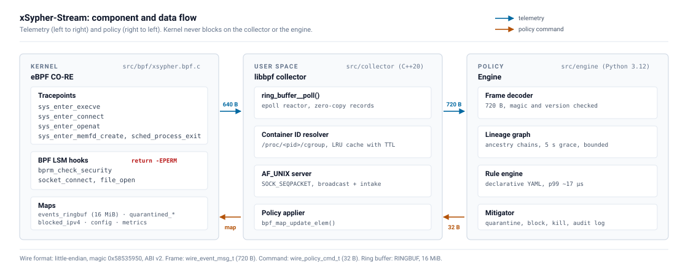

<div align="center">


<br/>

**Zero-trust kernel telemetry and inline LSM enforcement for AI-agent and MCP workloads.**

Observe every `execve`, `connect`, `openat` and `memfd` in the kernel. Reconstruct who spawned whom.
When a prompt injection turns an MCP tool call into a shell, a reverse shell, a metadata-credential
grab or a fileless payload — quarantine the process tree **inside the kernel**, before the next
syscall completes.

<br/>

<!-- build & quality ------------------------------------------------ -->
<a href="#build-from-source"></a>
<a href="scripts/verify_and_benchmark.sh"></a>
<a href="docs/architecture.svg"></a>

<!-- stack ----------------------------------------------------------- -->


<br/>
<sub><b>P99 rule evaluation 17 µs</b> · <b>136k events/s</b> per engine core · <b>16 MiB</b> lockless ring buffer · <b>720-byte</b> wire frames · <b>0</b> non-stdlib Python dependencies beyond PyYAML</sub>

</div>



---

## Table of contents

| Understand | Get running | Operate | Trust |
|---|---|---|---|
| [Why this exists](#why-this-exists) | [Quickstart](#quickstart) | [Binary ABI](#binary-abi) | [Security model](#security-model) |
| [How it works](#how-it-works) | [Build from source](#build-from-source) | [Metrics](#metrics) | [Performance](#performance) |
| [Anatomy of a contained breakout](#anatomy-of-a-contained-breakout) | [Run](#run) | [Audit trail](#audit-trail) | [Verification](#verification) |
| [Live monitor](#live-monitor) | [Configuration](#configuration) | [Deployment](#deployment) | [Compatibility](#compatibility) |
| [Detection catalogue](#detection-catalogue) | [Troubleshooting](#troubleshooting) | [Contributing](#contributing) | |

---

## Why this exists

Autonomous agents change the blast radius of a single tool call. A Model Context Protocol server is
a **general-purpose capability broker** wired directly into a language model's output. One
successful prompt injection is therefore not "a bad completion" — it is remote command execution
inside your workload, with your service account, on your network.

Classic controls do not see it:

| Control | Why it misses an MCP breakout |
|---|---|
| WAF / API gateway | The payload is a *legitimate* tool invocation, not malformed HTTP |
| Image scanning | The image is unmodified; the shell is `/bin/sh`, which is supposed to be there |
| K8s NetworkPolicy | `169.254.169.254` is link-local, not pod-to-pod traffic |
| Runtime agents with polling | A `node → python3 → sh → curl` chain completes in milliseconds |
| Egress proxies | Metadata service and C2 over 443 look like normal dependencies |

xSypher-Stream closes that gap by moving the decision into the **syscall path**. It is not a
sandbox and it is not an agent: it is a high-rate sensor plus a kernel-resident kill switch that is
already resident in the call chain, so a decision costs microseconds and an enforcement costs a map
update — not a container restart.

> **Design invariant:** the kernel never waits for user space. Telemetry is fire-and-forget through
> a lockless ring buffer; policy arrives asynchronously through BPF maps. If the engine dies, the
> kernel keeps enforcing the last policy it was given, and the engine releases its quarantines on
> graceful shutdown.

---

## How it works

<div align="center">

</div>

**One event, end to end** — the numbered hops in the diagram:

| # | Hop | Module | Cost |
|---|-----|--------|------|
| 1 | Tracepoint fires; `BPF_CORE_READ` walks `task_struct` for lineage/namespaces; record reserved on the ring buffer | `src/bpf/xsypher.bpf.c` | ~1 µs |
| 2 | `ring_buffer__poll()` inside the collector's epoll reactor; `cgroup_id`/`pid` resolved to a container ID via LRU cache | `bpf_loader.cpp`, `cgroup_resolver.cpp` | ~0.4 µs cached |
| 3 | Frame wrapped with `magic`, `version`, `msg_type`, monotonic `seq_no`, `container_id`; broadcast on `AF_UNIX`/`SOCK_SEQPACKET` | `uds_server.cpp` | ~2 µs |
| 4 | Engine decodes the 720-byte datagram, updates the lineage graph, evaluates rules | `abi.py`, `lineage.py`, `rule_engine.py` | 5–20 µs |
| 5 | On a match: `wire_policy_cmd_t` (32 B) sent back; collector calls `bpf_map_update_elem()`; **LSM hooks now return `-EPERM`** for that domain | `mitigator.py` → `bpf_loader.cpp` | ~2 ms round-trip |

Three planes, three languages, one contract:

```text
┌──────────────────────── kernel space · eBPF CO-RE ─────────────────────────┐
│  tp/syscalls/sys_enter_execve      lsm/bprm_check_security                 │
│  tp/syscalls/sys_enter_connect     lsm/socket_connect                      │
│  tp/syscalls/sys_enter_openat      lsm/file_open          ─┐               │
│  tp/syscalls/sys_enter_memfd_create                        │ -EPERM        │
│  tp/sched/sched_process_exit                              ─┘               │
│         │ ringbuf 16 MiB                          ▲ hash/array maps        │
└─────────┼─────────────────────────────────────────┼────────────────────────┘
          ▼                                         │
┌───────────────── user space · C++20 collector ─────┼───────────────────────┐
│  ring_buffer__poll → enrich → seq_no → broadcast   │ bpf_map_update_elem    │
└──────────────────────────┬─────────────────────────┴───────────────────────┘
                           │ AF_UNIX · SOCK_SEQPACKET
            720 B ▲         ▼ 32 B
┌──────────────────────────┴─────────────────────────────────────────────────┐
│  engine · Python 3.12 asyncio                                              │
│  decode → lineage → rules → mitigate → JSONL audit + Prometheus /metrics   │
└────────────────────────────────────────────────────────────────────────────┘
```

---

## Anatomy of a contained breakout

<div align="center">

</div>

The five-stage payload above is exactly what `tests/simulate_mcp_attack.py` replays and asserts
against on every CI run — five scenarios, eight expected enforcement packets, byte-compared.

```console
$ PYTHONPATH=src python3 tests/simulate_mcp_attack.py
  [2/3] injecting attack chains
        ok  chain A: MCP prompt injection -> interactive shell (2.1 ms)
        ok  chain B: MCP recon tool + reverse shell port (2.2 ms)
        ok  chain C: Cloud IMDS credential theft (2.2 ms)
        ok  chain D: Host credential harvest (2.2 ms)
        ok  chain E: Fileless payload staging via memfd (2.1 ms)

        enforcement pkts : 8 (expected 8)
          - quarantine_cgroup(cgroup=40961)
          - quarantine_pid(pid=10203)
          - block_ipv4(ip=203.0.113.9)
          - quarantine_pid(pid=10302)
          - quarantine_cgroup(cgroup=40963)
          - block_ipv4(ip=169.254.169.254)
          - quarantine_pid(pid=10402)
          - quarantine_cgroup(cgroup=40965)
        audit chain      : verified (8 record(s))
```

---

## Live monitor

<div align="center">

</div>

Line-oriented by design: the same output can be piped into a log pipeline (colour auto-disables on
non-TTY or `NO_COLOR=1`). `--quiet` prints only alerts.

---

## Detection catalogue

Six high-precision detections ship in [`config/rules.yaml`](config/rules.yaml). They are **data, not
code** — no rebuild is required to change them.

| ID | Severity | Fires when | Kernel response | ATT&CK |
|---|---|---|---|---|
| `MCP_SHELL_BREAKOUT` |  | an AI/MCP ancestor (`node`, `python3`, `uvicorn`, `deno`, `bun`, `claude-mcp`, …) spawns `sh`, `bash`, `zsh`, `dash`, `ksh`, `tmux`, `screen` | `QUARANTINE_CGROUP` + `SIGKILL` | T1059, T1059.004 |
| `MCP_RECON_OR_EXFIL_TOOL` |  | an AI/MCP ancestor launches `curl`, `wget`, `nc`, `socat`, `nmap`, `ssh`, `scp`, `base64`, `chisel`, `ngrok`, … | `QUARANTINE_PID` + `SIGKILL` | T1046, T1041, T1105 |
| `CLOUD_IMDS_CREDENTIAL_THEFT` |  | a container connects to `169.254.169.254` (AWS/GCP/Azure/OCI IMDS) or `fd00:ec2::254` | `QUARANTINE_CGROUP` + `BLOCK_IPV4` + `SIGKILL` | T1552.005 |
| `SENSITIVE_CREDENTIAL_HARVEST` |  | a non-authorised binary opens `/etc/shadow`, `/etc/sudoers`, `/root/.ssh`, K8s SA token, `.env`, `id_rsa`, `credentials.json`, `/proc/kcore` | `QUARANTINE_PID` + `SIGKILL` | T1003.008, T1552.001 |
| `FILELESS_MEMFD_EXECUTION` |  | `memfd_create()` — or exec from `/memfd:`, `/proc/self/fd/`, `/dev/shm/`, `/run/shm/` | `QUARANTINE_CGROUP` + `SIGKILL` | T1620, T1027.009 |
| `SUSPICIOUS_OUTBOUND_C2_PORT` |  | a container or web/MCP worker connects to `4444`, `1337`, `31337`, `5555`, `6667`, `9001` | `QUARANTINE_PID` + `BLOCK_IPV4` + `SIGKILL` | T1571, T1071 |

Each detection carries a `cooldown_seconds` window (default 5 s) per `(rule, pid)` so a fork loop
produces one alert and one map update, not thousands.

---

## Quickstart

Want to see it move in 60 seconds, with **no root, no eBPF, no kernel changes**? The synthetic mode
drives the complete Python path — decoder, lineage, rules, mitigation, hash-chained audit, metrics
and TUI:

```bash
git clone https://github.com/anwariqbaldawar/Zero-Trust-Kernel-Log-Streamer.git
cd Zero-Trust-Kernel-Log-Streamer
pip install -r requirements.txt          # PyYAML only

# 1. watch it detect synthetic MCP breakouts
PYTHONPATH=src python3 -m engine.main --simulate --metrics-port 9109

# 2. inspect the live metrics in another shell
curl -s localhost:9109/metrics | grep -E '^xsypher_(alerts|events)_total'

# 3. verify the tamper-evident audit chain
PYTHONPATH=src python3 -c "from engine.mitigator import AlertLog; \
print(AlertLog.verify('/var/log/xsypher-alerts.jsonl'))"
```

From a clean checkout in this environment, that is:

```console
$ PYTHONPATH=src python3 -m pytest tests -q
59 passed, 31 subtests passed in 0.45s

$ PYTHONPATH=src python3 tests/simulate_mcp_attack.py
RESULT: PASSED - all attack chains were detected and contained,
        every expected wire_policy_cmd_t was delivered.
```

---

## Build from source

### Prerequisites

| Component | Requirement | Debian / Ubuntu package |
|---|---|---|
| Kernel | ≥ 5.10 with BTF; `CONFIG_BPF_LSM=y` + `lsm=bpf` for **inline blocking** | — |
| Compiler (BPF) | `clang` ≥ 12 | `clang llvm` |
| Skeleton + BTF | `bpftool` | `bpftool` (or `linux-tools-$(uname -r)`) |
| libbpf | ≥ 1.0 | `libbpf-dev libelf-dev zlib1g-dev` |
| Compiler (user space) | `g++` ≥ 12 or `clang++` | `build-essential` |
| Runtime (engine) | Python ≥ 3.10 (3.12 recommended) | `python3 python3-yaml` |
| Build (optional) | CMake ≥ 3.20 | `cmake pkg-config` |

```bash
sudo apt-get install -y clang llvm bpftool libbpf-dev libelf-dev zlib1g-dev \
                        build-essential python3 python3-yaml
```

### Option A — Make (recommended)

```bash
make check-deps        # confirms clang / g++ / bpftool are visible
make -j"$(nproc)"      # build/xsypher.bpf.o + build/xsypher.skel.h + build/xsypher-collector
```

The architecture is detected automatically (`-D__TARGET_ARCH_x86` on x86_64,
`-D__TARGET_ARCH_arm64` on aarch64). `include/vmlinux.h` is generated from the running kernel's BTF
by [`scripts/gen_vmlinux.sh`](scripts/gen_vmlinux.sh) and is **git-ignored** — it is a build artifact
of the target kernel, never a checked-in file.

### Option B — CMake

```bash
cmake -S . -B build -DCMAKE_BUILD_TYPE=Release
cmake --build build -j"$(nproc)"
ctest --test-dir build --output-on-failure
```

CMake additionally generates `compile_commands.json` for clangd/IDE integration, and skips the BPF
target with an explicit warning instead of failing when `clang`/`bpftool` are absent.

### Build targets

| Target | Produces |
|---|---|
| `make` / `make all` | everything below |
| `make bpf` | `build/xsypher.bpf.o`, `build/xsypher.skel.h` |
| `make collector` | `build/xsypher-collector` |
| `make test` | pytest (falls back to `unittest` if pytest is absent) |
| `make simulate` | 10k-event end-to-end attack simulation |
| `make verify` | [`scripts/verify_and_benchmark.sh`](scripts/verify_and_benchmark.sh) |
| `make install` | binary, engine package, rules and systemd units (`DESTDIR` aware) |

---

## Run

Two processes, one socket. The collector owns the kernel side; the engine owns policy.

```bash
# terminal 1 — kernel side (needs CAP_BPF/CAP_PERFMON, i.e. root on most hosts)
sudo ./build/xsypher-collector \
    --socket-path /run/xsypher/stream.sock \
    --block-imds \
    --enforce \
    --verbose

# terminal 2 — policy side
sudo -E PYTHONPATH=src python3 -m engine.main \
    --socket-path /run/xsypher/stream.sock \
    --rules config/rules.yaml \
    --alert-log /var/log/xsypher-alerts.jsonl \
    --enforce-kernel
```

### `xsypher-collector` flags

| Flag | Default | Meaning |
|---|---|---|
| `--socket-path <path>` | `/run/xsypher/stream.sock` | Unix socket to bind; falls back to `/tmp/xsypher-stream.sock` when `/run` is not writable |
| `--enforce` | off | Start with `config_map[0] = INLINE_BLOCK` |
| `--block-imds` | off | Pre-block `169.254.169.254` in `blocked_ipv4_map` |
| `--no-lsm-fallback` | off | Fail hard instead of degrading to telemetry-only when BPF-LSM is unavailable |
| `--no-status` | off | Silence the 10-second status line |
| `--verbose` | off | Full libbpf logging |
| `-h`, `--help`, `-V`, `--version` | — | Usage / ABI version |

### `engine.main` flags

| Flag | Default | Meaning |
|---|---|---|
| `--socket-path` | `/run/xsypher/stream.sock` | Collector socket (also `XSYPHER_SOCKET`) |
| `--rules` | `config/rules.yaml` | Rule document (YAML or JSON; also `XSYPHER_RULES`) |
| `--alert-log` | `/var/log/xsypher-alerts.jsonl` | Hash-chained audit log (also `XSYPHER_ALERT_LOG`) |
| `--metrics-host` / `--metrics-port` | `0.0.0.0` / `9109` | Prometheus exporter (`0` = ephemeral port) |
| `--enforce-kernel` | off | Send quarantine commands to the eBPF maps (otherwise audit-only) |
| `--active-kill` | off | Also `SIGKILL` the offending PID from user space |
| `--simulate`, `--simulate-count`, `--simulate-seed` | off | Synthetic generator for testing without root/eBPF |
| `--lineage-ttl`, `--max-tracked` | `5.0`, `200000` | Grace window and graph bound |
| `--fsync-alerts` | off | `fsync` after every audit record |
| `--no-color`, `--quiet`, `--verbose` | — | Presentation |

### Exit codes

| Code | Meaning |
|---|---|
| `0` | Clean shutdown (signal received, policy released) |
| `1` | Fatal: BPF object could not load, socket unavailable, unusable alert-log directory |
| `2` | Invalid command line |

---

## Configuration

### Rule document schema

```yaml
version: "2"

settings:
  max_ancestry_depth: 8      # how far up the process tree to inspect
  cooldown_seconds: 5.0      # duplicate-alert suppression per (rule, pid)
  verify_chain_on_start: true

rules:
  - id: MCP_SHELL_BREAKOUT            # unique, stable, appears in alerts + metrics
    title: "MCP/AI agent spawned an interactive shell"
    severity: critical                # info | low | medium | high | critical
    description: >-
      Free-form analyst context, copied into the audit record.
    enabled: true
    event_types: [execve]             # execve connect openat memfd_create process_exit lsm_block
    conditions:
      exe_in: [sh, bash, zsh, dash, ksh, tmux, screen, dtach]
      ancestor_has_ai_runtime: true
      ancestor_min_depth: 1
    actions: [quarantine_cgroup, kill]  # quarantine_pid quarantine_cgroup block_ipv4 block_imds kill
    tags: [mcp, prompt-injection, rce]
```

**Condition semantics.** A `conditions:` mapping is **ANDed**; a list value is **ORed** internally;
the special `any_of:` key holds a list of condition groups that are **ORed** with each other.

| Condition | Type | Meaning |
|---|---|---|
| `event_types` | list | restrict to these kernel events |
| `exe_in` / `exe_not_in` | list | subject executable basename (lineage-resolved for non-exec events) |
| `exe_prefix_in` / `exe_suffix_in` | list | raw `filename` prefix/suffix — fileless detection |
| `comm_in` / `comm_not_in` | list | 16-byte kernel `comm` |
| `path_prefix_in` / `path_suffix_in` / `path_contains` | list | opened file path tests |
| `args_contains` | list | joined `argv` substring match |
| `dport_in` / `daddr_in` | list | destination port (host order) / IPv4 or IPv6 literal |
| `uid_in` / `uid_not_in` | list | subject credential |
| `container_only` | bool | only fire inside a non-host cgroup |
| `container_or_comm_in` | list | fire in a container **or** for these binaries |
| `ancestor_has_ai_runtime` | bool | any ancestor is an AI/MCP runtime |
| `ancestor_any_in` | list | any ancestor basename in an explicit list |
| `ancestor_min_depth` | int | require N ancestors |
| `monitor_only` | bool | alert, never enforce |
| `any_of` | list | OR of condition groups |

Validation is strict and fails at load time with a precise message: unknown conditions, unknown
event types, unknown actions, duplicate ids, invalid severities and empty rule sets are all rejected.
Both YAML and JSON documents are accepted (`--rules` with a `.json` file needs no PyYAML).

---

## Binary ABI

[`include/xsypher_abi.h`](include/xsypher_abi.h) is the single source of truth;
[`src/engine/abi.py`](src/engine/abi.py) mirrors it with `ctypes` and asserts every size and offset at
import time. All structures are `packed, aligned(8)` with explicit padding, so clang, g++ and ctypes
agree byte for byte. The C header cross-checks itself against the Python mirror in CI, and
`verify_and_benchmark.sh` re-compiles the header with the host compiler and diffs the sizes.

| Structure | Bytes | Layout |
|---|---|---|
| `struct kernel_event_t` | **640** | `timestamp_ns` 0 · `cgroup_id` 8 · `pid` 16 · `tgid` 20 · `ppid` 24 · `uid` 28 · `gid` 32 · `mnt_ns_id` 36 · `pid_ns_id` 40 · `net_ns_id` 44 · `event_type` 48 · `retval` 52 · `blocked_by_lsm` 56 · `af_family` 57 · `dport` 58 · `sport` 60 · `daddr_v4` 64 · `saddr_v4` 68 · `daddr_v6` 72 · `open_flags` 88 · `comm` 92 · `parent_comm` 108 · `filename` 124 · `args` 380 |
| `struct wire_event_msg_t` | **720** | `magic` 0 · `version` 4 · `msg_type` 6 · `seq_no` 8 · `container_id` 16 · `event` 80 |
| `struct wire_policy_cmd_t` | **32** | `magic` 0 · `version` 4 · `cmd_type` 6 · `target_cgroup_id` 8 · `target_pid` 16 · `target_ipv4` 20 · `enforcement_mode` 24 |

**Constants.** `XSYPHER_WIRE_MAGIC = 0x58535950` (`"XSYP"`), `XSYPHER_ABI_VERSION = 2`,
`MAX_COMM_LEN = 16`, `MAX_PATH_LEN = 256`, `MAX_ARGS_LEN = 256`, `MAX_CONTAINER_ID_LEN = 64`,
ring buffer `16 MiB`.

**Event types.** `EXECVE=1`, `CONNECT=2`, `OPENAT=3`, `MEMFD_CREATE=4`, `PROCESS_EXIT=5`,
`LSM_BLOCK=6`.

**Policy commands.** `QUARANTINE_PID=10`, `UNQUARANTINE_PID=11`, `QUARANTINE_CGROUP=12`,
`UNQUARANTINE_CGROUP=13`, `BLOCK_IPV4=14`, `UNBLOCK_IPV4=15`, `SET_ENFORCEMENT_MODE=16`
(`0 = AUDIT_ONLY`, `1 = INLINE_BLOCK`).

**Two conventions worth memorising**

1. **Network byte order everywhere.** IPs and ports are stored exactly as the kernel produced them in
   `sockaddr_in`. On a little-endian host, `169.254.169.254` is therefore `0xFEA9FEA9`
   (`XSYPHER_IMDS_IPV4_RAW` in C, `abi.IMDS_IPV4_RAW` in Python). Never compare against
   `inet_aton()` output without converting.
2. **`container_id` is fixed width, not necessarily NUL-terminated.** A 64-hex Docker/containerd/CRI-O
   id fills all 64 bytes; shorter values (`"host"`) are NUL padded. Both decoders accept both shapes.

---

## Metrics

Zero-dependency Prometheus exporter on `:9109`, `text/plain; version=0.0.4`:

```text
# HELP xsypher_events_total Kernel telemetry events processed, by type
# TYPE xsypher_events_total counter
xsypher_events_total{type="execve"} 18422
xsypher_events_total{type="connect"} 9103

xsypher_alerts_total{rule="MCP_SHELL_BREAKOUT",severity="critical"} 1
xsypher_mitigations_total{action="quarantine_cgroup"} 1
xsypher_active_tracked_processes 214
xsypher_rule_cooldowns_active 3
xsypher_lsm_blocks_seen{type="lsm_block"} 7
xsypher_commands_sent_total{command="quarantine_cgroup"} 1
xsypher_commands_failed_total{reason="disconnected"} 0
xsypher_socket_reconnects_total 0
xsypher_rule_eval_seconds_sum 0.0521
xsypher_rule_eval_seconds_count 27525
xsypher_engine_uptime_seconds 61.4
```

| Series | Type | Use |
|---|---|---|
| `xsypher_events_total{type}` | counter | throughput and event mix per sensor |
| `xsypher_alerts_total{rule,severity}` | counter | alert rate by detection (primary SLO signal) |
| `xsypher_mitigations_total{action}` | counter | enforcement actions actually delivered |
| `xsypher_active_tracked_processes` | gauge | lineage graph occupancy / memory proxy |
| `xsypher_rule_cooldowns_active` | gauge | suppression pressure on the hot path |
| `xsypher_lsm_blocks_seen` | counter | kernel denials observed (proves enforcement is live) |
| `xsypher_commands_sent_total` / `_failed_total` | counter | policy channel health |
| `xsypher_socket_reconnects_total` | counter | collector restarts |
| `xsypher_rule_eval_seconds` | summary | hot-path latency (`_sum` / `_count`) |
| `xsypher_engine_uptime_seconds` | gauge | liveness context |

`GET /healthz` returns `200 ok` for Kubernetes probes. The container also exports
`prometheus.io/scrape: "true"`, `prometheus.io/port: "9109"` annotations on the pod template.

**Suggested alerts**

```yaml
- alert: XsypherEnforcementDown
  expr: increase(xsypher_commands_failed_total[5m]) > 0
  for: 5m
  description: "xSypher cannot push policy to the collector — enforcement is blind."

- alert: XsypherAlertFlood
  expr: sum(rate(xsypher_alerts_total[5m])) > 5
  for: 10m
  description: "Sustained breakout attempts across the cluster."

- alert: XsypherSensorStalled
  expr: rate(xsypher_events_total[10m]) == 0
  for: 15m
  description: "No kernel telemetry for 15 minutes — sensor is dead or detached."
```

---

## Audit trail

Every alert becomes one JSONL record with a **SHA-256 hash chain**, so the log is tamper-evident
without any external infrastructure:

```text
hash_n = SHA256( hex(hash_{n-1}) || canonical_json(record_n \ {hash, alert_id}) )
hash_0 = "0" * 64
```

```json
{
  "schema": "xsypher.alert.v2",
  "alert_id": "5f26e3f956c98122",
  "sequence": 0,
  "prev_hash": "0000000000000000000000000000000000000000000000000000000000000000",
  "hash": "5f26e3f956c98122995f6a9f5f6ea9529a6790a484fcb803c736f5d39807e026",
  "timestamp": "2026-10-26T16:24:16.647876388Z",
  "rule": "MCP_SHELL_BREAKOUT",
  "severity": "critical",
  "subject": { "pid": 2413, "tgid": 2413, "comm": "sh", "uid": 1000,
               "cgroup_id": 40961, "container_id": "26101d6e…780f",
               "mnt_ns_id": 4026531840 },
  "event": { "type": "execve", "filename": "/bin/sh",
             "args": "-c 'curl http://169.254.169.254/latest/meta-data/iam/'" },
  "ancestry": ["python3", "mcp-server"],
  "mitigations": [
    { "action": "quarantine_cgroup", "command": "quarantine_cgroup",
      "target": 40961, "delivered": true }
  ],
  "enforced": true
}
```

Editing or deleting any line breaks every subsequent hash. The engine re-verifies the chain on
startup and reports `audit hash chain is INVALID` if it does not add up:

```bash
PYTHONPATH=src python3 -c "from engine.mitigator import AlertLog; \
print(AlertLog.verify('/var/log/xsypher-alerts.jsonl'))"
# (True, 8, None)
```

Ship it anywhere: `vector`/`fluent-bit` tail → SIEM; the `hash` and `prev_hash` fields travel with
each event so downstream consumers can re-verify independently.

---

## Deployment

| Target | Path | Notes |
|---|---|---|
| Docker Compose | [`deploy/docker-compose.yml`](deploy/docker-compose.yml) | privileged collector + `cap_drop: ALL` engine |
| Kubernetes | [`deploy/kubernetes-daemonset.yaml`](deploy/kubernetes-daemonset.yaml) | DaemonSet, one pod per node, hostPID + hostNetwork |
| systemd | [`deploy/xsypher-collector.service`](deploy/xsypher-collector.service), [`deploy/xsypher-engine.service`](deploy/xsypher-engine.service) | bare metal / VM, capability-scoped |
| Container image | [`deploy/Dockerfile`](deploy/Dockerfile) | multi-stage build, slim runtime, non-root engine |

### Docker Compose

```bash
cd deploy && docker compose up --build
curl -s localhost:9109/metrics | head
```

### Kubernetes

```bash
kubectl apply -f deploy/kubernetes-daemonset.yaml
kubectl -n xsypher logs -f ds/xsypher-stream -c engine
```

The engine container runs with `readOnlyRootFilesystem`, `capabilities.drop: [ALL]`,
`allowPrivilegeEscalation: false`; only the collector is privileged, and the socket lives on a
memory-backed `emptyDir` shared by the two containers. A `PodDisruptionBudget` keeps sensor coverage
during rollouts.

### systemd

```bash
sudo make install
sudo useradd --system --no-create-home --shell /usr/sbin/nologin xsypher
sudo systemctl daemon-reload
sudo systemctl enable --now xsypher-collector xsypher-engine
journalctl -u xsypher-collector -u xsypher-engine -f
```

### Provisioning checklist

- [ ] Kernel ≥ 5.10, `CONFIG_DEBUG_INFO_BTF=y` (verify: `ls /sys/kernel/btf/vmlinux`)
- [ ] For **inline blocking**: `CONFIG_BPF_LSM=y` and `lsm=bpf` in `GRUB_CMDLINE_LINUX`
      (verify: `cat /sys/kernel/security/lsm`)
- [ ] `RLIMIT_MEMLOCK` raised (the unit sets `LimitMEMLOCK=infinity`; containers set `ulimits.memlock: -1`)
- [ ] Socket directory writable by both processes (`/run/xsypher`, mode `0750`)
- [ ] Alert log on durable storage, or shipped by a log agent (records are append-only)
- [ ] `--block-imds` enabled on any node hosting workloads that do not legitimately need IMDS
- [ ] Prometheus scraping `:9109/metrics`, and the three alert rules above wired to a pager

---

## Troubleshooting

| Symptom | Diagnosis | Fix |
|---|---|---|
| `WARNING: BPF-LSM unavailable … continuing in telemetry-only mode` | `bpf_program__set_autoload()` disabled the LSM hooks because the kernel rejected them | Rebuild the kernel with `CONFIG_BPF_LSM=y`, boot with `lsm=bpf`, or accept telemetry-only + `--active-kill` |
| `error: cannot load BPF object: … EPERM` | Missing capabilities or `RLIMIT_MEMLOCK` | Run as root / grant `CAP_BPF` + `CAP_PERFMON`; raise memlock |
| `cannot bind …/stream.sock (Permission denied)` | `/run` is not writable by the launching user | The collector retries `/tmp/xsypher-stream.sock`; or `install -d -m 0750 /run/xsypher` |
| `unable to connect to collector socket` | Collector not running, or engine started first | Start the collector first; the engine retries every second and logs reconnects |
| Alerts appear but nothing is blocked | Engine started without `--enforce-kernel`, or LSM inactive | Restart with `--enforce-kernel`; check `xsypher_lsm_blocks_seen` increments |
| `audit hash chain is INVALID` | Log edited/truncated, or written by two engines concurrently | Restore from backup; run one engine per log path |
| `bpftool: command not found` during build | `linux-tools` missing | `apt-get install bpftool` (or `linux-tools-$(uname -r)`) |
| `no usable kernel BTF found` | `gen_vmlinux.sh` wrote the documented stub header | Install `linux-image-$(uname -r)-dbg` or `bpftool`; re-run with `FORCE=1` |
| High `xsypher_events_total` from a chatty host | `openat` filter too tight for this workload | Widen `is_writable_staging_path()` in `xsypher.bpf.c` or filter in the rule set |

---

## Security model

**Trust boundaries.** The collector is the only privileged component. It parses no untrusted input
beyond fixed-size kernel records, and it never interprets policy — it applies 32-byte commands
verbatim. The engine holds no capabilities: it is a normal user-space process whose only influence on
the kernel is the narrow policy channel above.

| Asset | Protection |
|---|---|
| Collector socket | `AF_UNIX` + `SOCK_SEQPACKET`, created `0750` in `/run/xsypher`; local only, never a TCP port |
| Policy channel | Every command is re-validated for `magic`, `version` and `cmd_type`; unknown commands are logged and dropped |
| Alert log | SHA-256 chained; tampering is detectable offline without the engine |
| Engine container | `cap_drop: ALL`, `readOnlyRootFilesystem`, `no-new-privileges`, non-root |
| Metrics endpoint | Read-only, no secrets; bind to loopback or keep it behind the Service if the network is untrusted |
| Rule documents | Loaded once at startup; a malformed or unknown rule aborts the load rather than silently disabling protection |

**Fail-safe behaviour.** No BPF-LSM → degrade to telemetry and say so in the status line. Engine
crash → the kernel keeps the last policy. Graceful stop → the engine emits `UNQUARANTINE_*` for
everything it applied, so a restart cannot leave a node locked down. Ring buffer full → drop and
count (`METRIC_RINGBUF_DROPS`); the syscall path is never blocked.

**Explicit non-goals.** xSypher-Stream is not a sandbox, an admission controller, a vulnerability
scanner, or an image-signing verifier. It detects *behaviour* of already-running processes. It does
not stop an attacker who has root and unloads the sensor — pair it with immutable infrastructure and
audit-log shipping.

**Reporting a vulnerability.** Please read [`SECURITY.md`](SECURITY.md) and report privately; do not
open a public issue.

---

## Performance

Measured on a 2-vCPU sandbox (Debian 12, `g++ 12`, CPython 3.11), replaying 10,016 events through
the engine:

| Metric | Measured | Budget | Headroom |
|---|---|---|---|
| Rule evaluation **p50** | 6.25 µs | — | — |
| Rule evaluation **p95** | 11.65 µs | — | — |
| Rule evaluation **p99** | **17.3 µs** | 500 µs | 29× |
| Rule evaluation **max** | 1.33 ms (first event, cold caches) | — | — |
| In-process throughput | **136k events/s** | — | — |
| End-to-end throughput (encode → socket → decode → rules → JSONL) | **38k events/s** | — | — |
| Policy round-trip (detection → kernel map update) | **2.1–3.8 ms** | — | — |
| Ring buffer | 16 MiB lockless | — | ~10k events of headroom before drops |

The hot path is allocation-light by construction: sets and tuples are pre-normalised at load time,
the ancestry chain is resolved once per event (not once per rule), and a per-`(rule, pid)` cooldown
stops repeated work on the same subject.

**Scaling guidance.** One collector per node (it is per-kernel). One engine can serve one or more
collectors; if you centralise engines, keep them on the same host as the socket — the transport is
Unix-domain by design, and there is no TCP fallback to accidentally expose.

---

## Verification

One command proves the whole chain:

```bash
./scripts/verify_and_benchmark.sh            # full: 10,000 events + 5 attack chains
./scripts/verify_and_benchmark.sh --quick    # 2,000 events
```

```console
$ ./scripts/verify_and_benchmark.sh
==> 1/5  ABI parity (include/xsypher_abi.h <-> src/engine/abi.py)
  PASS  struct layouts identical in C and Python (640 720 32)
==> 2/5  eBPF CO-RE object (src/bpf/xsypher.bpf.c)
  PASS  BPF object + skeleton built
==> 3/5  C++20 collector (src/collector)
  PASS  collector built
==> 4/5  Python unit tests
  PASS  pytest suite
==> 5/5  End-to-end MCP attack simulation (10000 benign events + 5 chains)
  PASS  simulation: all attack chains detected and contained

  passed=5 failed=0 skipped=0
RESULT: OK - xSypher-Stream verified end to end
```

What each layer asserts:

| Suite | Tests | Covers |
|---|---|---|
| [`tests/test_wire_protocol.py`](tests/test_wire_protocol.py) | 23 | exact struct sizes/offsets, **cross-language parity by compiling the C header**, codec round-trips (IPv4/IPv6/truncation/bad magic/bad version), command encoding, a real `SOCK_SEQPACKET` round trip against a mock collector |
| [`tests/test_lineage_and_rules.py`](tests/test_lineage_and_rules.py) | 36 | ancestry chains, depth limits, cycle breaking, TTL grace window, LRU bounds, all six rules firing *and* staying quiet on benign traffic, cooldowns, rule-validation errors, hash-chain write/verify/tamper/restart, Prometheus rendering + live HTTP fetch, TUI, CLI config |
| [`tests/simulate_mcp_attack.py`](tests/simulate_mcp_attack.py) | end-to-end | 10k benign events + 5 attack chains over a real socket, byte-comparison of every expected `wire_policy_cmd_t`, audit-chain verification, throughput and p99 benchmarks |

**Toolchain transparency.** In sandboxes without `clang`/`bpftool`/`libbpf-dev`, the script reports
the BPF and collector steps as `SKIP` (never `FAIL`) and still runs the ABI cross-check, the full test
suite and the simulation. Locally, the collector also type-checks clean under
`-Wall -Wextra -Wpedantic`, and the BPF program is verified with `gcc -fsyntax-only` against the
generated BTF header. The authoritative build runs in CI on a host with the full toolchain — see
[`.github/workflows/ci.yml`](.github/workflows/ci.yml).

---

## Compatibility

| Axis | Supported | Notes |
|---|---|---|
| Kernel | 5.10 → 6.x | CO-RE means one object, no recompilation per kernel |
| Architectures | `x86_64`, `aarch64` | `-D__TARGET_ARCH_x86` / `_arm64` selected automatically |
| Distros | Any with BTF (`CONFIG_DEBUG_INFO_BTF`) | Ubuntu 20.04+, Debian 11+, RHEL 9+, Amazon Linux 2023, Talos, Bottlerocket |
| Containers | Docker, containerd, CRI-O | 64-hex ids parsed from `/proc/<pid>/cgroup`; anything else reports `host` |
| Python | 3.10, 3.11, 3.12, 3.13 | 3.12 is the reference runtime |
| libbpf | ≥ 1.0 (1.1+ for epoll-driven ring buffer) | older 1.x falls back to timed polling |
| Inline blocking | `CONFIG_BPF_LSM=y` + `lsm=bpf` | otherwise telemetry-only mode |

---

## Contributing

```bash
git clone https://github.com/anwariqbaldawar/Zero-Trust-Kernel-Log-Streamer.git
cd Zero-Trust-Kernel-Log-Streamer
pip install -r requirements.txt pytest
make test && ./scripts/verify_and_benchmark.sh --quick
```

Please read [`CONTRIBUTING.md`](CONTRIBUTING.md) for the rule-authoring guide, the ABI change policy
(**any** change to `include/xsypher_abi.h` must bump `XSYPHER_ABI_VERSION`, update
`src/engine/abi.py`, and extend the layout tests), the commit conventions and the review checklist.
Security issues go through [`SECURITY.md`](SECURITY.md), never a public issue.

**Licence.** Apache-2.0 for user space; the BPF object declares `SEC("license") = "GPL"` because the
kernel requires a GPL-compatible licence for BPF-LSM program types. See [`LICENSE`](LICENSE).

---

<div align="center">

<sub><b>xSypher-Stream</b> · ABI v2 · built for people who have to answer the question<br/>
<i>“what exactly did that agent do on this host, and what did we do about it?”</i></sub>

<br/><br/>


</div>
